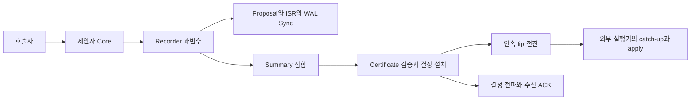

# Rhiza Go QuePaxa 구현 역명세

- 기준일: 2026-10-30 (Asia/Seoul)
- 기준 저장소: `github.com/mrchypark/rhiza`
- 기준 커밋: `8acb6da35a4c6fc83fa14ecec2fe2b64370fa4bd` (분석 시작 시 로컬 `origin/main`)
- Go 선언: `1.27.3`
- 분석 경로: `/Users/cypark/.codex/worktrees/quepaxa-go-reverse-spec/rhiza`

이 문서는 Go의 `pkg/quepaxa`와 직접 연결되는 `pkg/network`, `pkg/node`의 현재 동작을 도출한 운영 역명세다. 새로운 설계나 논문 준수 판정이 아니며, 문서만으로 구현한 독립 재구현의 동등성이 입증된 상태도 아니다. 코드에서 확인한 계약, 테스트에 정의된 기대, 기존 실행 결과를 구분한다. 세부 근거는 아래 네 부록을 함께 읽는다. 하위 QLog의 물리 파일 형식과 데이터베이스 실행기의 전체 명세는 범위 밖이다.

| 부록 | 포함하는 근거 |
|---|---|
| [직렬화 형식](quepaxa-go-formats-2026-10-30.md) | 정확한 Go 필드·JSON 태그·바이트 인코딩·control prefix·디코더 수용 규칙 |
| [합의·API 상세](quepaxa-go-protocol-evidence-2026-10-30.md) | 메시지, 기본값, ISR, 제안 단계, 인증서, 읽기·학습·취소 |
| [영속성·복구 상세](quepaxa-go-durability-evidence-2026-10-30.md) | WAL payload, Sync 경계, replay, checkpoint, compaction, Local 비용·공간 회수 |
| [멤버십·연동·검증 상세](quepaxa-go-membership-evidence-2026-10-30.md) | freeze/drain/terminal, learner, 전파 quorum, 인증·fencing, 테스트 결과 |

## 1. 역할과 처리 경계

Core는 값의 순서를 slot별로 결정한다. 제안자는 구성원의 recorder에 요청하고, recorder는 slot별 요약 레지스터인 ISR을 갱신한다. 결정에는 과반수 recorder의 summary를 담은 certificate가 붙는다. learner는 인증된 결정을 받아 보관한다. 데이터베이스가 실제 값을 실행하는 것은 Core 밖의 책임이다.

`New`는 voter, `NewObserver`는 수동 verifier, `NewLearner`는 비투표 replica를 만든다. observer·learner의 ID는 초기 voter 집합 밖에 있어야 한다. learner는 인증된 후속 구성이 자신의 ID와 WALIdentity를 포함하고 활성화 조건을 만족해야 voter가 된다. [생성 조건][config], [투표 가능 조건][voting]

`NewLearner`는 기존 WAL identity를 사용하거나 무작위 32바이트를 생성해 WAL에 bind한다. 생성·bind 실패나 32바이트가 아닌 identity는 오류다. `WALIdentity()`가 반환하는 소문자 hex를 후보 등록·목표 member·admission probe에 동일하게 사용한다. 등록된 voter를 다시 열려면 그 값과 일치하는 원래 WAL identity가 필요하다. [identity 생성·재개방](https://github.com/mrchypark/rhiza/blob/8acb6da35a4c6fc83fa14ecec2fe2b64370fa4bd/pkg/quepaxa/config.go#L117)



그림은 일반 제안의 구성 요소를 보여 준다. `ProposeCertified`는 후속 completion·전파를 생략한다. 실제 ACK 경계는 5절을 따른다.

## 2. 입력, 식별자, 기본값

`Slot`과 `Step`은 `uint64`, `NodeID`는 문자열이다. `ValueHash`와 priority는 각각 32바이트이다. value hash는 SHA-256이다. proposal 순서는 `(priority, proposer ID의 바이트열, hash)`를 사전식으로 비교하며 nil은 모든 실재 proposal보다 작다. payload는 이 비교에 직접 참여하지 않는다. [proposal 비교][protocol]

`Cluster`는 `ConfigID:uint`와 member 배열이다. member에는 ID, URL, PeerURL, LogURL, Ed25519 공개키, 선택적 WALIdentity가 있다. 개인키는 membership에 복제하지 않는다. node ID·WAL·비어 있지 않은 구성은 필수이고 member ID는 유일해야 한다. 복수 voter의 일반 Core에는 transport가 필요하다. [구성 필드][types], [생성 검증][config]

| 항목 | 현재 값 또는 계약 |
|---|---|
| quorum | `floor(N/2)+1` |
| 첫 예약 slot / 실행 step | `1` / `4` |
| 제안 pipeline | permit 16개 |
| leader epoch | 16개 slot |
| 제안·staging value 상한 | 128 KiB; 모든 결정 수신 경로의 보편적 상한은 아님 |
| read barrier nonce | 16바이트 |
| group commit | timer 25µs, 조기 wake 기준 64 waiters |
| 재구성 | 기본 비활성화, `EnableReconfiguration`으로 선택 |
| LocalMode | 명시적 선택, singleton 구성만으로 켜지지 않음 |

25µs와 64는 지연 SLA나 엄격한 batch 크기 상한이 아니다. 실제 디스크 Sync와 스케줄링 시간이 추가된다. [기본값 상세](quepaxa-go-protocol-evidence-2026-10-30.md), [group commit][group]

## 3. Recorder와 proposer의 상태 전이

ISR은 `Step`, `FirstCurrent`, `AggregateCurrent`, `AggregatePrior`를 가진다. 현재 step을 t, 입력을 s, 입력 proposal을 p라 한다.

| 조건 | 새 Step | FirstCurrent | AggregateCurrent | AggregatePrior |
|---|---|---|---|---|
| s < t | 유지 | 유지 | 유지 | 유지 |
| s = t | 유지 | 유지 | `max(기존,p)` | 유지 |
| s = t+1 | s | p | p | 이전 AggregateCurrent |
| s > t+1 | s | p | p | nil |

응답 summary는 recorder ID, 재구성 ID, step, FirstCurrent, AggregatePrior를 담는다. AggregateCurrent는 응답에 없다. 일반 Record는 slot 0과 step 4 미만을 거부한다. payload를 staging하거나 기존 hash 대응 값을 확인한 뒤 ISR을 기록하며, 정상 summary 반환은 Sync 성공 뒤에 이루어진다. 이미 결정한 slot에는 기존 결정 proposal을 담은 summary를 반환한다. [ISR][protocol], [Record][record]

제안자는 slot을 예약하며 실패한 미결정 slot을 재사용할 수 있다. 최초 leader의 새 slot은 최고 priority를 쓰고, 다른 proposer·재사용 slot은 무작위 priority를 쓴다. 각 step은 처음 성공한 recorder quorum으로 진행하며 나머지 RPC context를 취소한다. [제안 경로][propose], [phase][phases]

| phase (`step % 4`) | 동작 |
|---|---|
| 0 | step 4에서 모든 FirstCurrent가 같은 최고 priority proposal이면 빠르게 결정한다. 그 외에는 FirstCurrent의 최댓값을 채택한다. |
| 1 | 다음 step으로 이동한다. |
| 2 | 현재 proposal이 AggregatePrior의 최댓값과 같으면 결정한다. |
| 3 | AggregatePrior의 최댓값을 채택하고 다음 round로 간다. |

summary step이 맞지 않으면 가장 높은 step의 FirstCurrent를 채택해 그 step에서 재시작한다. payload가 없으면 로컬 또는 recorder에서 hash에 맞는 값을 가져온다. 후보가 없거나 step이 overflow하면 오류다. 경쟁자의 값이 결정되면 그 결정을 보존하고 자신의 요청을 다시 제안한다. 일반 round 횟수나 완료 시간의 상한은 없다. 같은 payload를 다시 호출하면 다른 slot에서 다시 결정될 수 있다.

고정 구성의 epoch는 `(slot-1)/16`이다. 재구성 모드에서는 구성 시작 S(성공 terminal 이후 `T+1`, genesis는 1)를 기준으로 `e=(slot−S)/16`을 사용한다. 각 구성의 첫 `2N+1`개 epoch에는 member 배열을 회전하고 이후에는 `S+16(e−1)`의 순서를 사용한다. 순서 제어 slot은 `e+1>=2N+1`인 `S+16e`다. genesis 3-node 구성의 첫 제어 slot은 97이고 그 순서는 113부터 적용된다. 제어 값은 `51 4c 44 52 00` 뒤의 JSON 배열이다. 이 slot에는 사용자 값 대신 순서가 들어가고 사용자 제안은 계속 진행한다. 순서는 모든 voter를 정확히 한 번 포함해야 한다. 관측된 epoch 완료 시간의 이동 평균을 정렬에 쓰지만 최적 성능을 보장하지 않는다. [leader 상세](quepaxa-go-protocol-evidence-2026-10-30.md)

## 4. Certificate의 수용 조건과 신뢰 가정

Certificate JSON에는 config ID, slot, step, 결정 proposal 참조와 summary 참조 집합이 들어간다. proposal 참조는 priority·proposer ID·hash를 담고 payload를 생략한다. `reconfiguration_id`는 각 summary 안에 있으며 0이면 인코더가 생략한다. hash·priority는 숫자 배열이다. 디코더는 unknown field와 뒤따르는 추가 JSON을 거부한다. 중복 key까지 거부하는 canonical JSON 계약은 확인되지 않았다. 정확한 필드와 다른 codec의 수용 규칙은 [형식 부록](quepaxa-go-formats-2026-10-30.md)을 따른다. [형식][certificate]

결정 검증은 slot·value hash·구성·고유 recorder 소속·과반수·summary step 일치를 검사한다. 빠른 결정은 step 4, 지정 leader, 최고 priority, 동일한 FirstCurrent 집합을 요구한다. phase 2 결정은 AggregatePrior의 최댓값과 결정 proposal의 일치를 요구한다. 다른 phase는 거부한다. 외부 DecidedValue 수신은 certificate와 외부 slot·hash·payload·ConfigID의 일치도 검사한다. [결정 검증][validation]

이 certificate에는 recorder별 서명이 없다. 네트워크는 Ed25519 공개키를 고정한 TLS/QUIC peer 인증을 사용한다. 수신 권한은 해당 요청의 역사적 구성과 로컬 현재 구성 양쪽의 voter·공개키에 의존한다. 따라서 저장된 certificate를 독립적으로 검증 가능한 서명 quorum 증명이나 Byzantine 내성으로 해석하지 않는다. [peer 인증][peer-auth]

검증기의 관찰 가능한 경계도 남긴다. phase 2 검증에는 독립적인 `Step>=4` 또는 proposer membership 검사가 없다. `IsQuorum(receipts)`는 Accepted인 고유 member 수만 세며 receipt 간 slot·hash 일치를 검사하지 않는다. 이것은 현재 검사 범위의 기술이며, 공격 경로가 재현된 취약점 판정은 아니다. [검증 세부](quepaxa-go-protocol-evidence-2026-10-30.md)

## 5. 결정, 영속성, 응답 완료

다음 상태는 별개이다: 값 staging, 값 Sync 완료, ISR 기록, 인증된 결정 설치, QDEC Append 완료, QDEC Sync 완료, 연속 tip 도달, 다른 replica의 ACK. sparse 결정만으로 tip이 gap을 건너뛰지 않는다. 같은 slot의 다른 hash·payload 비교는 보존된 결정에 한한다. floor 이하의 `AcceptDecision`은 검증 후 재설치·QDEC 없이 성공할 수 있지만 Record·고정 구성 certified page·페이지 조회·CompleteDecision은 거부한다. EnsureDurable은 base coverage를 성공으로 인정하고 DurablePrefix는 0을 제외한 floor 이하를 거부한다. [floor별 상세 계약](quepaxa-go-protocol-evidence-2026-10-30.md), [설치][install]

128KiB는 제안·staging 검사이며 일반 Decision 검증과 certified-value binding에는 보편적 길이 검사가 없다. certified page는 원자적 transaction이 아니므로 뒤 항목 실패 전에 앞 항목이 설치·Append될 수 있다. [크기·부분 설치 계약](quepaxa-go-protocol-evidence-2026-10-30.md)

| API | 성공 반환의 계약 |
|---|---|
| `StoreValue` | 값의 Sync 완료이며 결정은 아님 |
| `Record` | 정상 receipt의 Append와 Sync 완료 |
| `ProposeCertified` | durable recorder quorum으로 인증된 결정. 후속 completion 생략. client ACK 전에 호출자가 추가 voter 설치 계약을 이행해야 함 |
| `Propose` | 요청한 값의 결정, 앞선 gap 복구, 연속 tip, completion 및 transport의 결정 전파 성공 |
| `AcceptDecision` | 검증·설치 후 로컬 QDEC 영속화 |
| `AcceptDecisionHint` | 일반 결정은 추가 디스크 장벽 없이 설치. 재구성 control은 durable 경로 사용 |
| `AcceptCertifiedValueForAck` | 자기 ID가 certificate에 있고 일치하는 live ISR과 durable value가 있으면 recorder 영속성을 재사용. 아니면 durable 설치 |
| `EnsureDurable` | 해당 slot 영속화. terminal control은 retained prefix까지 처리 |
| `EnsureDurableThrough` | 연속 retained prefix의 누락 QDEC를 기록하고 Sync. gap이면 오류 |
| `CompleteDecision` | 알려진 결정의 completion·전파 재시도 |

복수 voter의 일반 Propose completion은 recorder 영속성을 재사용할 수 있고 로컬 QDEC를 Append만 한 뒤 전파할 수 있다. 그러므로 성공 응답마다 새 로컬 QDEC Sync가 반드시 있었다고 명세화하면 안 된다. singleton·Local 및 명시적 durable API의 경계와 구별한다. [completion][completion], [ACK 최적화][ack]

Core의 Transport 인터페이스는 `SendDecision`에서 error만 받는다. 현재 `pkg/network.Transport`의 일반 결정 전파는 로컬 learner를 1로 세고 원격 ACK를 더하여 과반수일 때 성공한다. freeze는 기존 quorum에 더해 freeze certificate의 모든 recorder ACK를 요구한다. 성공 terminal은 이전 구성 quorum과 다음 구성 quorum, 새로 추가된 모든 member의 ACK를 요구한다. 이 조건은 recorder 단계 quorum과 구별된다. [일반 전파][network-decision], [freeze 전파][freeze-send], [terminal 전파][terminal-send]

운영 `OperationLearned` 수신자는 readiness·execution policy를 검사하고 결정을 설치한 뒤 연속 prefix를 기다리고 해당 slot까지 apply해야 ACK한다. apply 실패로 합의 상태가 바뀐 뒤에도 전파가 실패할 수 있다. handler는 certificate의 자기 recorder ID만으로 hint를 선택하며, live ISR·durable value까지 확인하는 `AcceptCertifiedValueForAck`와 다르다. [운영 ACK 상세](quepaxa-go-membership-evidence-2026-10-30.md)

Sync·취소 오류는 미기록을 뜻하지 않는다. group commit 참가자의 취소는 batch에서 해당 작업을 제거하거나 진행 중 Sync를 취소하지 않는다. Local recorder 작업은 `WithoutCancel`로 자체 receipt를 끝낸 후 원래 취소를 확인할 수 있다. 실패·취소 후에도 기록이나 결정이 남을 수 있으므로 호출자 요청의 exactly-once 실행은 별도 계층의 책임이다. [group commit][group], [취소 상세](quepaxa-go-durability-evidence-2026-10-30.md)

## 6. 읽기, 학습, catch-up

`ReadIndex`는 처음 성공한 read quorum의 tip 중 최댓값과 그 응답자 ID를 반환한다. 전체 cluster의 최신 tip을 기다리거나 로컬 replica를 catch-up시키지는 않는다. `ReadIndexExcluding`은 제외 voter에 연락하지 않되 원래 구성의 quorum 크기를 유지하며, 자기 자신 제외는 실패한다. observer·비투표자·freeze 중에는 참여가 제한된다. `51 52 44 42 00`과 16바이트 nonce를 가진 read barrier 값은 별도이며 ReadIndex 자체가 이를 제안하지 않는다. [읽기][reads]

완료된 쓰기의 learner quorum과 read quorum의 교집합이 읽기 논리의 근거다. 그러나 반환 index까지의 값 가져오기와 실행 완료는 호출자 책임이다. 이 문서와 패키지 테스트만으로 데이터베이스 전체의 선형화 가능 읽기를 입증하지 않는다.

`Learn`은 버퍼 100의 알림 채널이다. 초기 결과는 map 순서이고 버퍼 초과·후속 느린 수신에서 알림이 유실될 수 있다. 초기 from 필터는 후속 알림에 다시 적용되지 않으며 context 취소 시 채널을 닫지 않는다. 따라서 무손실 재생은 `DecisionsFrom` 계열과 연속 tip을 사용해야 한다. 일반 페이지의 from=0은 1, 비양수 limit는 256이다. bounded 페이지는 양수 item·byte budget을 요구하고 value+certificate 크기를 센다. 첫 항목이 budget보다 크면 오류이고 뒤의 항목이 넘으면 앞선 연속 페이지까지만 반환한다. [학습·페이지][learn]

두 페이지 API의 두 번째 반환값은 페이지 끝이나 다음 cursor가 아니라 조회 당시 tip이다. 다음 요청은 마지막 반환 slot+1을 사용한다. from이 tip보다 크면 빈 페이지, floor 이하이면 `ErrCompacted`이며 recovery base 처리는 API 밖에서 해야 한다. gap은 오류이고 부분 페이지를 반환하지 않는다. [정확한 signature·반환값](quepaxa-go-protocol-evidence-2026-10-30.md)

## 7. WAL, 재개방, checkpoint와 compaction

| WAL entry | QuePaxa payload |
|---|---|
| Proposal | 원시 value bytes |
| Receipt | `51 49 53 52 00` + identifier `QISR`의 FlatBuffers ISR |
| 재구성 Receipt | `51 49 53 52 32 00` + FlatBuffers ISR |
| 재구성 capability marker | slot 0, payload는 정확히 `51 49 53 52 32 00` |
| Decide | `51 44 45 43 00` + value와 certificate의 JSON |
| Checkpoint | floor·prefix·root·leader 순서·membership 등을 담은 consensusBase JSON |
| CheckpointVerified | 인코딩한 checkpoint seal |

Proposal replay는 빈 값과 hash 불일치를 거부한다. ISR codec은 길이·identifier·proposal priority/hash 길이를 검사하고 FlatBuffers panic을 오류로 바꾼다. codec만으로 모든 프로토콜 불변식을 검사하지는 않는다. 재구성 WAL을 재구성 비활성 Core로 열면 실패한다. QDEC는 인증서·값을 검증하고 충돌 결정을 거부한다. 정렬한 결정에서 연속 prefix만 전진시킨다. malformed base·prepared marker 및 동일 index의 상충 root도 실패한다. [codec][codec], [replay][replay]

이 계층의 receipt/QDEC replay에는 payload identity와 outer entry slot/hash를 직접 대조하지 않는 분기가 있고, 열거하지 않은 entry type은 통과한다. 하위 QLog의 검사까지 포함한 전체 손상 방어 판정은 이 명세 범위 밖이다.

prefix hash 갱신은 `SHA256(domain || previous32 || slot의 uint64 big-endian8 || valueHash32)`이며 domain은 ASCII `rhiza/decision-prefix` 뒤 실제 `0x00`이다. checkpoint state index와 seal이 결정된 slot은 서로 다를 수 있다. [prefix 계산][prefix], [identity 정의](quepaxa-go-formats-2026-10-30.md)

호출자는 각 recorder에 `SetCheckpointValidator`로 객체 검증 callback을 등록하고 `PrepareCheckpoint`를 성공시킨 뒤 인코딩한 seal을 제안한다. 새 준비에는 validator가 필수이며, 이미 준비한 같은 index/root는 현재 identity 검사 후 callback 재실행 없이 성공할 수 있다. prepare는 config·prefix·leader 순서·lineage·membership를 확인하고 validator 성공 후 누락 prefix QDEC, CheckpointVerified를 Append·Sync한다. `Record`는 checkpoint 값을 식별해 `RequirePreparedCheckpoint`를 요구한다. 낮은 prepared index와 같은 index의 다른 root는 거부한다. seal 학습 후에야 아래 compaction 전제를 충족할 수 있다. [prepare][prepare], [등록·Record 검사](https://github.com/mrchypark/rhiza/blob/8acb6da35a4c6fc83fa14ecec2fe2b64370fa4bd/pkg/quepaxa/core.go#L1635)

`CompactThrough(T,R)`는 비영 T/R, `floor<T<=tip`, 정확한 sealed root와 prepared root, prefix와 leader 순서를 요구한다. 재구성 중에는 압축하지 않는다. rewrite Build 동안 잠금을 풀고 Commit 전에 floor·membership version·suffix를 다시 확인하며, 별도 validation Core로 suffix 재생을 검증한다. unresolved ISR 및 unlogged 결정이 필요로 하는 값은 남겨야 한다. 설치 후 base 이하 개별 결정·recorder와 불필요한 값을 제거한다. checkpoint 객체 보존·실제 파일 삭제는 외부 책임이다. [compaction][compact]

`InstallFencedGenerationBase`는 별도의 외부 관리 권한 전환이다. caller가 anchor를 검증해야 하며 이 API는 source quorum certificate나 checkpoint validator callback을 요구하지 않는다. 비어 있는 target Core/WAL(초기 capability marker만 허용), bootstrap ConfigID 일치와 정확한 anchor retry를 요구하고 lineage를 replay 이후에도 유지한다. anchored 초기 base에만 재구성 history 생략 예외가 있다. [외부 generation base 상세](quepaxa-go-durability-evidence-2026-10-30.md)

## 8. 멤버십 전환

현재 opt-in 전환은 한 번에 voter 한 명을 추가하거나 제거한다. 목표 ConfigID는 정확히 현재+1이고 유지되는 member의 모든 필드는 같아야 한다. 퇴역 ID 재사용은 거부한다. 추가 member의 WALIdentity는 소문자 64자리 hex이다. 이 검사만으로 공개키·endpoint 유효성까지 보장하지 않는다. [목표 검증][target]

기존 구성 C, 목표 C′, freeze slot F, terminal slot T에 대해 `T=F+16`이다.

| 구간 | 상태와 조건 |
|---|---|
| 시작 | pipeline을 독점하고 F=tip+1 선택. F/T가 leader schedule slot과 겹치면 경계를 조정. 너무 앞선 알려진 slot이 있으면 거부 |
| F | 직전 prefix·목표·T를 묶은 freeze 결정. 그 certificate의 recorder 집합을 safe로 고정 |
| F+1…T−1 | 기존 구성으로 15개 slot drain·복구·완료. 일반 사용자 제안은 freeze 동안 차단 |
| T | 동일 F/T/목표와 T−1 prefix를 묶은 terminal. summary는 freeze hash를 ReconfigurationID로 포함. terminal recorder 후보는 safe 집합 |
| 성공 이후 | C′는 T+1부터 슬롯을 소유. 제거 ID는 retired로 기록 |
| abort 이후 | 추가만 abort 가능. 기존 구성 유지, 최신 abort 증거와 revision 보존. 제거는 abort 불가 |

freeze와 terminal의 적용은 연속 prefix를 따른다. terminal 학습으로 CurrentCluster가 바뀌더라도 terminal의 로컬 durability가 없으면 새 epoch의 투표를 허용하지 않는다. compact된 terminal은 검증된 membership base로 확인한다. [전환][reconfig], [투표][voting]

재구성 Record는 tip+16 초과를 거부하고 해당 slot의 ConfigID를 요구한다. freeze 이후 T 초과를 거부하며 F 이후 요청에 freeze ID를 요구한다. catch-up 요구량은 비활성 모드 또는 slot=0이면 0, terminal이면 `slot−1`, 나머지는 `slot>16`일 때만 `slot−16`, 그 외에는 0이다. 새 voter 추가 성공 terminal은 admission callback이 필수이고, 노드는 후보의 정확한 WALIdentity와 durable prefix를 QUIC probe로 확인한다. prefix 확인은 투표권 부여와 별개이다. [연동 상세](quepaxa-go-membership-evidence-2026-10-30.md)

MembershipRecord는 genesis, 성공한 freeze→terminal 전환, 선택적인 최신 abort 증거를 담는다. 성공 전환의 두 결정은 durable해야 한다. history 검증은 신뢰한 bootstrap과 정확히 같은 genesis에서 출발한다. 재구성 checkpoint에는 history가 필수이고 고정 구성 seal에는 history를 허용하지 않는다. 활성 freeze 중 checkpoint 추출은 거부하고 포함되는 성공 terminal은 checkpoint index보다 앞서야 한다. history만으로 모든 drain 값의 실행이나 checkpoint 객체의 존재가 입증되지는 않는다. [history 검증][history]

## 9. 관리 API와 fencing 경계

관리 요청은 노드 mutex로 직렬화하며 OperationID·ClusterID·예상 ConfigID·추가/제거 중 하나와 abort revision을 검사한다. journal은 예상 ConfigID와 abort slot으로 키를 만들고 동일 키의 다른 요청은 conflict다. 노드 API는 자기 자신 제거를 거부한다. 제거에는 Confirmed fence, 일치하는 NodeID/WALIdentity/등록 nonce와 비어 있지 않은 WorkloadUID·Evidence가 필요하다. [노드 관리][node-membership]

이 검사는 대상 프로세스 종료·재생성 방지·진행 중 스토리지 쓰기 종료를 직접 입증하지 않는다. 외부 관리 주체의 증거를 신뢰하는 경계이며 MembershipStatus도 관찰용이다. HTTP 변경 요청은 POST·membership bearer token, 64KiB JSON 상한, unknown field·추가 데이터 거부, 30초 callback 제한을 적용한다. [HTTP·상태][membership-http]

## 10. LocalMode의 추가 계약

LocalMode는 자기 자신 한 voter, transport 없음, 재구성 비활성, 양의 유한 WAL capacity를 요구한다. WAL은 caller 소유이지만 Core 활성 중 외부 Append·Compact·limit 변경·Bind·공유를 금지한다. singleton 일반 Core와 다르다. 외부 recorder 변이 API도 거부한다. [Local 설정][config]

Local 공간 회수는 execution owner를 유지한 채 `정확한 root 검증 → 사전 공간 승인 → prepare → seal 결정 또는 기존 seal 재사용 → seal까지 durable prefix → 외부 apply → root 재검증 → checkpoint index까지 compact` 순서로 진행한다. apply는 seal 결정 slot까지 처리해야 하며, owner를 다시 획득하는 Core 작업으로 재진입하면 안 된다. 실패 시 자동 rollback이나 apply exactly-once는 없다. [공간 회수][reclamation]

LocalCheckpointRoots는 live 상태와 WAL에 남아 있는 root 근거를 모아 반환하며 직접 파일을 삭제하지 않는다. 수집에 충돌·decode·scan 오류가 있으면 부분 결과 없이 실패한다. archive 페이지 import는 tip+1의 연속 값 전체를 사전 검증하고 Append·Sync 뒤 설치한다. pending ISR/unlogged 결정이 있으면 import를 거부한다. 중간 I/O·설치 실패는 재개방이 필요한 불확실한 결과이다. [Local archive·root 상세](quepaxa-go-durability-evidence-2026-10-30.md)

비용 모델은 현재 QLog header 53바이트를 실제 인코딩 길이와 대조한다. P(v)=53+v, D(v)=85+4×ceil(v/3)+certificate 상한(길이 0이면 2 추가), B(v)=P(v)+3×receipt 상한+D(v)이다. V=128KiB일 때 foreground=B(v)+B(V), recovery 한 slot=B(V), checkpoint=P(V)+2B(V)이다. 실제 미결정 suffix는 별도로 계산한다. 승인 조건은 `used+immediate+protected<=limit`이고 overflow는 거부한다. 전용 admission 거부만 쓰기 전 거부로 분류하며 일반 capacity·I/O 오류와 구분한다. 이 계산은 공간 예약 자체가 아니다. [비용 모델][cost]

## 11. 실행 검증과 남은 검증 범위

지정 Go 체크아웃에서 다음 명령을 실행했다.

```sh
go test -mod=readonly -count=1 -timeout=120s ./pkg/quepaxa
```

```text
ok  github.com/mrchypark/rhiza/pkg/quepaxa  101.932s
exit_code=0
```

패키지 실행은 통과했다. 정적으로 발견한 207개의 Test/Fuzz/Benchmark 정의가 모두 실행되었다는 의미는 아니다. 상세 부록의 테스트 표는 각 테스트가 정의한 기대의 위치를 제공한다. 주요 범위는 ISR 전이, 경쟁 제안, minority 거부, read 제외, Sync 오류, bounded 페이지, membership 변조·abort·복구·checkpoint 및 Local 공간 회수이다.

이번에 `pkg/node`·`pkg/network` 테스트, race, fuzz campaign, 전체 CI, 실제 객체 저장소·Kubernetes·Chaos Mesh를 실행하지 않았다. Go 기준점에는 `scripts/e2e-fast.sh`와 `scripts/check-ci.sh`가 없다. 임의 메시지 스케줄의 안전성 증명, 유한 시간 종료, 전원 장애의 내구성, 전체 데이터베이스의 선형화 가능성, Byzantine 내성을 패키지 통과에서 도출하지 않는다.

테스트 실행 에이전트는 자신이 시작한 Go PID 7807과 테스트 PID 8042의 종료 및 임시 go-build 디렉터리 제거를 확인했다. 별도 서버·컨테이너·클러스터는 시작하지 않았다. 구현 파일·의존성·사용자 데이터는 변경하지 않았다.

## 12. 문서와 구현의 차이를 읽는 방법

`pkg/quepaxa/doc.go`의 “Core 수명 동안 fixed membership” 및 “성공 제안이 로컬 durable”이라는 짧은 설명만으로는 opt-in 재구성이나 recorder 영속성 재사용을 설명할 수 없다. 이 명세는 실제 경로를 기준으로 5절과 8절에서 조건을 나눴다. 이는 기존 주석을 수정한 결과가 아니다.

빈 payload도 주의가 필요하다. 일반 Propose 입구에는 명시적 거부가 없지만 staging은 빈 값을 거부하고 hydration도 빈 결과를 성공으로 취급하지 않는다. 빈 payload의 일관된 지원 계약은 확인되지 않았다. Learn의 유실 가능성, 서명 없는 certificate, fencing의 외부 증거 의존도 현재 관찰된 계약으로 보존했다. 수정안이나 과거의 설계 선택 이유는 역명세에 임의로 추가하지 않았다.

EGM에서는 재구현 표준에 따라 근거를 수집하고, 새 대화 문맥의 Goldfish가 코드 일치성과 문서 이해 가능성을 독립 검토했다. 두 검토자가 지적한 항목은 수정 후 해당 검토자의 재점검에서 해소되었다. [검토 결과와 수정 이력](quepaxa-go-egm-review-2026-10-30.md)에 원문·처리 상태·미검토 범위를 기록한다. 이 작업을 신규 설계의 전체 5단계 승인이나 독립 재구현 인증으로 표현하지 않는다.

[config]: https://github.com/mrchypark/rhiza/blob/8acb6da35a4c6fc83fa14ecec2fe2b64370fa4bd/pkg/quepaxa/config.go#L16
[voting]: https://github.com/mrchypark/rhiza/blob/8acb6da35a4c6fc83fa14ecec2fe2b64370fa4bd/pkg/quepaxa/core.go#L172
[protocol]: https://github.com/mrchypark/rhiza/blob/8acb6da35a4c6fc83fa14ecec2fe2b64370fa4bd/pkg/quepaxa/protocol.go#L23
[types]: https://github.com/mrchypark/rhiza/blob/8acb6da35a4c6fc83fa14ecec2fe2b64370fa4bd/pkg/quepaxa/types.go#L72
[group]: https://github.com/mrchypark/rhiza/blob/8acb6da35a4c6fc83fa14ecec2fe2b64370fa4bd/pkg/quepaxa/group_commit.go#L9
[record]: https://github.com/mrchypark/rhiza/blob/8acb6da35a4c6fc83fa14ecec2fe2b64370fa4bd/pkg/quepaxa/core.go#L1371
[propose]: https://github.com/mrchypark/rhiza/blob/8acb6da35a4c6fc83fa14ecec2fe2b64370fa4bd/pkg/quepaxa/core.go#L353
[phases]: https://github.com/mrchypark/rhiza/blob/8acb6da35a4c6fc83fa14ecec2fe2b64370fa4bd/pkg/quepaxa/core.go#L985
[certificate]: https://github.com/mrchypark/rhiza/blob/8acb6da35a4c6fc83fa14ecec2fe2b64370fa4bd/pkg/quepaxa/certificate.go#L10
[validation]: https://github.com/mrchypark/rhiza/blob/8acb6da35a4c6fc83fa14ecec2fe2b64370fa4bd/pkg/quepaxa/core.go#L2591
[peer-auth]: https://github.com/mrchypark/rhiza/blob/8acb6da35a4c6fc83fa14ecec2fe2b64370fa4bd/pkg/network/peer_server.go#L334
[install]: https://github.com/mrchypark/rhiza/blob/8acb6da35a4c6fc83fa14ecec2fe2b64370fa4bd/pkg/quepaxa/core.go#L2201
[completion]: https://github.com/mrchypark/rhiza/blob/8acb6da35a4c6fc83fa14ecec2fe2b64370fa4bd/pkg/quepaxa/core.go#L2115
[ack]: https://github.com/mrchypark/rhiza/blob/8acb6da35a4c6fc83fa14ecec2fe2b64370fa4bd/pkg/quepaxa/core.go#L2714
[network-decision]: https://github.com/mrchypark/rhiza/blob/8acb6da35a4c6fc83fa14ecec2fe2b64370fa4bd/pkg/network/transport.go#L545
[freeze-send]: https://github.com/mrchypark/rhiza/blob/8acb6da35a4c6fc83fa14ecec2fe2b64370fa4bd/pkg/network/transport.go#L683
[terminal-send]: https://github.com/mrchypark/rhiza/blob/8acb6da35a4c6fc83fa14ecec2fe2b64370fa4bd/pkg/network/transport.go#L749
[reads]: https://github.com/mrchypark/rhiza/blob/8acb6da35a4c6fc83fa14ecec2fe2b64370fa4bd/pkg/quepaxa/core.go#L588
[learn]: https://github.com/mrchypark/rhiza/blob/8acb6da35a4c6fc83fa14ecec2fe2b64370fa4bd/pkg/quepaxa/core.go#L2965
[codec]: https://github.com/mrchypark/rhiza/blob/8acb6da35a4c6fc83fa14ecec2fe2b64370fa4bd/pkg/quepaxa/wal_codec.go#L12
[replay]: https://github.com/mrchypark/rhiza/blob/8acb6da35a4c6fc83fa14ecec2fe2b64370fa4bd/pkg/quepaxa/core.go#L3162
[prefix]: https://github.com/mrchypark/rhiza/blob/8acb6da35a4c6fc83fa14ecec2fe2b64370fa4bd/pkg/quepaxa/types.go#L33
[prepare]: https://github.com/mrchypark/rhiza/blob/8acb6da35a4c6fc83fa14ecec2fe2b64370fa4bd/pkg/quepaxa/core.go#L1671
[compact]: https://github.com/mrchypark/rhiza/blob/8acb6da35a4c6fc83fa14ecec2fe2b64370fa4bd/pkg/quepaxa/compaction.go#L238
[target]: https://github.com/mrchypark/rhiza/blob/8acb6da35a4c6fc83fa14ecec2fe2b64370fa4bd/pkg/quepaxa/reconfiguration.go#L280
[reconfig]: https://github.com/mrchypark/rhiza/blob/8acb6da35a4c6fc83fa14ecec2fe2b64370fa4bd/pkg/quepaxa/reconfiguration.go#L23
[history]: https://github.com/mrchypark/rhiza/blob/8acb6da35a4c6fc83fa14ecec2fe2b64370fa4bd/pkg/quepaxa/membership_validation.go#L8
[node-membership]: https://github.com/mrchypark/rhiza/blob/8acb6da35a4c6fc83fa14ecec2fe2b64370fa4bd/pkg/node/membership.go#L22
[membership-http]: https://github.com/mrchypark/rhiza/blob/8acb6da35a4c6fc83fa14ecec2fe2b64370fa4bd/pkg/network/membership.go#L56
[reclamation]: https://github.com/mrchypark/rhiza/blob/8acb6da35a4c6fc83fa14ecec2fe2b64370fa4bd/pkg/quepaxa/local_reclamation.go#L149
[cost]: https://github.com/mrchypark/rhiza/blob/8acb6da35a4c6fc83fa14ecec2fe2b64370fa4bd/pkg/quepaxa/local_cost.go#L72
